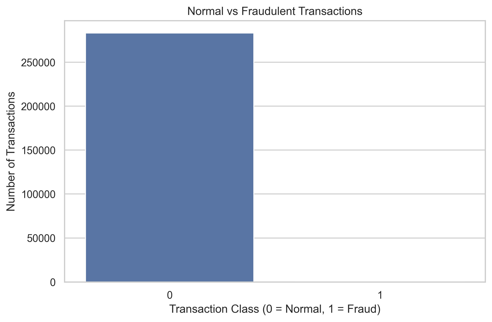
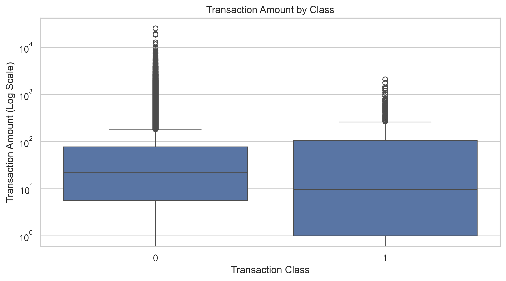
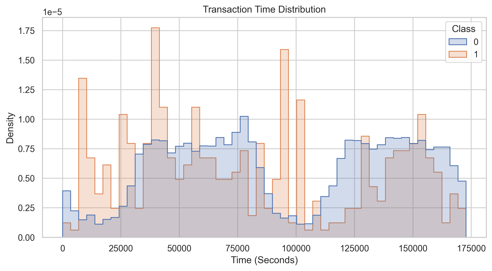
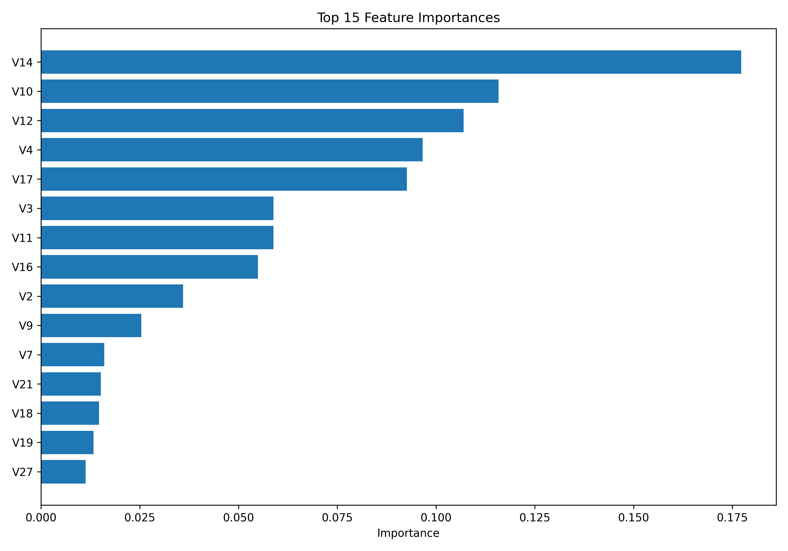

# Credit Card Fraud Detection

A machine learning project focused on detecting fraudulent credit card transactions using imbalanced classification techniques.

## Project Overview

Credit card fraud detection is a binary classification problem in which the goal is to identify fraudulent transactions while minimizing false alarms.

This project explores transaction data, handles class imbalance, trains multiple machine learning models, and compares their performance using precision, recall, F1-score, and Precision-Recall AUC.

## Dataset

The dataset contains anonymized credit card transactions made by European cardholders.

- Original transactions: 284,807
- Features: 30
- Target: `Class`
- Normal transactions: `0`
- Fraudulent transactions: `1`

The dataset contains PCA-transformed features (`V1`–`V28`), along with `Time` and `Amount`.

**Dataset source:** [Credit Card Fraud Detection – Hugging Face](https://huggingface.co/datasets/David-Egea/Creditcard-fraud-detection)

### Data Cleaning

Exact duplicate rows were removed before model training.

| Metric | Value |
|---|---:|
| Original rows | 284,807 |
| Duplicate rows removed | 1,081 |
| Cleaned rows | 283,726 |
| Normal transactions | 283,253 |
| Fraudulent transactions | 473 |

The cleaned dataset contains approximately 0.167% fraudulent transactions, demonstrating a severe class imbalance.

## Exploratory Data Analysis

The project includes analysis of:

- Class distribution
- Transaction amount distribution
- Transaction time distribution
- Duplicate transactions
- Feature importance

### Visualizations







### Feature Importance

The Random Forest model identified the following features as the most influential:

| Feature | Importance |
|---|---:|
| V14 | 0.1773 |
| V10 | 0.1158 |
| V12 | 0.1070 |
| V4 | 0.0966 |
| V17 | 0.0927 |



These values represent model-based feature importance, not causal relationships.

## Machine Learning Models

Two classification models were developed:

### 1. Logistic Regression

- StandardScaler preprocessing
- Balanced class weights
- Threshold optimization using validation data

### 2. Random Forest

- 100 decision trees
- Maximum depth: 12
- Minimum samples per leaf: 2
- Balanced class weights
- Threshold optimization using validation data

## Model Evaluation

The dataset was split into three stratified subsets:

- 70% Training
- 15% Validation
- 15% Testing

The validation set was used for threshold selection, while the test set was reserved for final evaluation.

### Final Test Results

| Metric | Logistic Regression | Random Forest |
|---|---:|---:|
| Decision Threshold | 0.90 | 0.40 |
| Precision | 25.2% | 83.3% |
| Recall | 84.5% | 77.5% |
| F1-Score | 0.39 | 0.80 |
| PR-AUC | 0.681 | 0.786 |
| False Positives | 178 | 11 |
| False Negatives | 11 | 16 |

### Random Forest Confusion Matrix

| | Predicted Normal | Predicted Fraud |
|---|---:|---:|
| Actual Normal | 42,477 | 11 |
| Actual Fraud | 16 | 55 |

Random Forest achieved a substantially better balance between precision and recall, with an F1-score of approximately 0.80.

Logistic Regression achieved slightly higher fraud recall, but generated considerably more false positives.

## Key Findings

- The dataset is extremely imbalanced, making accuracy an unreliable standalone metric.
- Random Forest outperformed Logistic Regression in F1-score and PR-AUC.
- Threshold optimization significantly affects the precision-recall trade-off.
- Features V14, V10, and V12 had the highest Random Forest feature importance scores.
- Evaluation on a separate test set provides a more reliable estimate of model performance.

## Project Structure

```text
Credit-Card-Fraud-Detection/
│
├── data/
│   ├── raw/
│   └── processed/
│
├── analyze_data.py
├── evaluate_model.py
├── evaluate_rf_model.py
├── feature_importance.py
├── inspect_data.py
├── inspect_duplicates.py
├── optimize_rf_threshold.py
├── optimize_threshold.py
├── prepare_data.py
├── train_model.py
├── train_random_forest.py
├── visualize_data.py
│
├── class_distribution.png
├── amount_distribution.png
├── time_distribution.png
├── feature_importance.png
│
├── .gitignore
└── README.md
```

## Technologies Used

- Python
- Pandas
- NumPy
- Matplotlib
- Seaborn
- Scikit-learn

## Limitations

- The dataset contains anonymized PCA-transformed features, limiting direct interpretation.
- The test set contains a relatively small number of fraudulent transactions.
- Results on this dataset do not guarantee performance on real-world banking transactions.
- This project is intended for educational and research purposes, not production fraud detection.

## Author

**Pasha**

Machine Learning | Data Analysis | Statistics
